  

# 🚀 Awesome Command Line HTTP Clients

  
  
  
  
  
  
  

> 🌐 **A curated collection of top-tier Command Line HTTP Clients, terminal-native REST/GraphQL/gRPC test runners, HTTP benchmarking tools, and CI/CD automated API quality assurance frameworks.**

Whether you are looking for universal network workhorses like **curl** and **wget**, human-friendly alternatives like **HTTPie** and **xh**, declarative test frameworks like **Hurl** and **Step CI**, load-testing beasts like **Vegeta** and **hey**, or modern terminal user interfaces (TUIs) like **posting**, this list indexes the best developer utilities for the command line.

---

## 📑 Table of Contents

- [📊 Sector Overview & Market Dynamics](#-sector-overview--market-dynamics)
- [🏢 SaaS/Hosted Platforms](#-saashosted-platforms)
- [💻 Open-Source GitHub Projects](#-open-source-github-projects)
  - [Top Projects (Ranked by GitHub_Stars)](#top-projects-ranked-by-github-stars)
  - [Specialized & Non-GitHub Tools](#specialized--non-github-tools)
- [🛠️ Frameworks for Building Custom Testing Systems](#️-frameworks-for-building-custom-testing-systems)
- [🤝 How to Contribute](#-how-to-contribute)
- [💡 Disclaimer & Engineering Insights](#-disclaimer--engineering-insights)
- [⭐ Star History](#-star-history)
- [💖 Support & Sponsorship](#-support--sponsorship)

---

## 📊 Sector Overview & Market Dynamics

The global API management and testing sector is estimated at **$12.5B–$15B** ($8.5B–$10.3B for API management and $4B–$4.9B for API testing/quality engineering), growing at **~18–22% CAGR** driven by microservices, cloud-native architectures, and automated CI/CD pipelines. 

The broader API infrastructure market exhibits **moderate concentration**—anchored by dominant platforms (Postman, Kong, hyperscalers) at the enterprise core—alongside a **moderately fragmented** and competitive developer tools periphery where open-source CLI utilities and agile challenger platforms continuously contest market share.

---

## 🏢 SaaS/Hosted Platforms

| Company / Product | Company Size (Valuation / Revenue) | Starting Paid Pricing | Free Tier Limits | Key Highlights & Capabilities |
| :--- | :--- | :--- | :--- | :--- |
| **[Postman CLI](https://www.postman.com/)** | **$5.6B valuation** (~$313M ARR) | **$9/user/month** (Solo / Basic plan billed annually, or $14 monthly; Team at $19/user/month) | **1 user**, 1,000 monitor requests/month, 50 AI credits, unlimited manual collection runs | Command-line collection runner and API testing tool for CI/CD integration with JUnit/HTML reporting and environment management. |
| **[Insomnia CLI](https://insomnia.rest/)** (Kong Inc.) | **$2.0B valuation** (Kong ARR >$100M) | **$12/user/month** (Pro plan billed annually; $45/user/month for Enterprise) | **Up to 3 users** (Git Sync projects), unlimited local/cloud projects, 1,000 mock requests/month, unlimited collection runs via Inso CLI | Native runner for Insomnia specs/collections, Git sync, environment switching, and CI/CD test execution backed by Kong Konnect. |
| **[RapidAPI CLI](https://rapidapi.com/)** (Nokia) | **$106M acquisition value** (~$40M-$45M ARR; formerly $1.0B peak valuation) | **$10/user/month** (RapidAPI for Teams starting tier after 5 free seats) | **First 5 team seats free forever**; API marketplace free tiers default up to 500,000 requests/month (or custom provider quotas) with 10 GB bandwidth | CLI tool for interacting with RapidAPI marketplace and enterprise hubs, managing API collections, and running terminal tests. |
| **[HTTPie Desktop & Cloud](https://httpie.io/)** | **$6.5M funding raised** (Seed stage, private revenue) | **$5/user/month** (Desktop/Team tier) | **Free forever** incognito/offline mode; unlimited local requests, unlimited CLI usage, and free preview access to AI requests and cloud sync upon sign-up | Clean, human-friendly API testing UI with cross-device sync and seamless companion CLI integration. |
| **[Apidog CLI](https://apidog.com/)** | **Bootstrapped / Private** (Non-disclosed revenue) | **$9/user/month** (Basic plan, or $18/user/month for Professional) | **Up to 4 users**, 5 team projects, 1 sprint branch/project, 10,000 cloud mock calls/month, unlimited automated collection & test runs | Visual design editor and headless CLI runner (`apifox run`) supporting CLI, HTML, JSON, and JUnit reporters with AI agent hints. |

---

## 💻 Open-Source GitHub Projects

### Top Projects (Ranked by GitHub_Stars)

The following open-source command line HTTP tools and test runners are sorted in descending order by GitHub stargazers. Each repository includes an official social Stars_Badge directly linking to its stargazers page.

1. **[curl](https://github.com/curl/curl)** 
   - **License:** curl License (MIT/X derivate) • **Language:** C
   - **The universal standard**—pre-installed on macOS, Windows 10/11, and virtually every Linux distribution. Supports HTTP/1.1, HTTP/2, HTTP/3, HTTPS, FTP, FTPS, SCP, SFTP, TFTP, DICT, TELNET, LDAP, FILE, MQTT, and WebSockets. The ultimate bedrock of data transfers and API scripting.

2. **[HTTPie CLI](https://github.com/httpie/cli)** 
   - **License:** BSD-3-Clause • **Language:** Python
   - **User-friendly command-line HTTP client for the API era.** Intuitive formatting syntax (`key=value` for strings, `key:=json` for typed data), automatic syntax highlighting, formatted JSON output, persistent sessions (`--session`), and pluggable authentication.

3. **[Vegeta](https://github.com/tsenart/vegeta)** 
   - **License:** MIT • **Language:** Go
   - **Versatile HTTP load testing tool and library.** Designed for testing HTTP services with constant request rates. Features lazy target streaming, low memory consumption, binary reporting formats, and fast command-line terminal plots.

4. **[hey](https://github.com/rakyll/hey)** 
   - **License:** Apache-2.0 • **Language:** Go
   - **Tiny, blazing-fast HTTP load generator.** A modern replacement for ApacheBench (`ab`), supporting HTTP/2, custom headers, worker concurrency, and terminal latency percentile breakdowns.

5. **[Hurl](https://github.com/Orange-OpenSource/hurl)** 
   - **License:** Apache-2.0 • **Language:** Rust (powered by libcurl)
   - **Declarative HTTP requests and automated REST API testing tool.** Written in plain text files that look like HTTP requests. Built-in assertions on status codes, headers, JSONPath, XPath, and regex. Seamlessly acts as a CI gate with the `--test` flag.

6. **[posting](https://github.com/darrenburns/posting)** 
   - **License:** Apache-2.0 • **Language:** Python (Textual)
   - **The modern API client that lives right inside your terminal.** Features a sleek, keyboard-centric terminal user interface (TUI), YAML-backed request collections, jump navigation, autocompletion, and scriptable environment configurations.

7. **[Wuzz](https://github.com/asciimoo/wuzz)** 
   - **License:** AGPL-3.0 • **Language:** Go
   - **Interactive CLI tool for HTTP inspection.** Provides a curses-like interactive TUI for modifying request parameters, headers, and body on the fly, with real-time response filtering using regex, JSON, and HTML queries.

8. **[oha](https://github.com/hatoo/oha)** 
   - **License:** MIT • **Language:** Rust
   - **HTTP load generator with real-time animated TUI.** Inspired by `hey`, written in Rust, featuring real-time terminal graphs, latency distributions, error histograms, and HTTP/2 support.

9. **[httpx](https://github.com/projectdiscovery/httpx)** 
   - **License:** MIT • **Language:** Go
   - **Fast and multi-purpose HTTP toolkit for reconnaissance and probing.** Supports high-concurrency URL probing, TLS/JARM fingerprinting, CDN detection, status code filtering, ASN mapping, and pipeline streaming.

10. **[HTTP Prompt](https://github.com/httpie/http-prompt)** 
    - **License:** MIT • **Language:** Python
    - **Interactive REPL command-line HTTP client built on HTTPie.** Provides context-aware auto-completion, real-time syntax highlighting, persistent session states, and integration with OpenAPI/Swagger specifications.

11. **[xh](https://github.com/ducaale/xh)** 
    - **License:** MIT • **Language:** Rust
    - **Friendly and fast tool for sending HTTP requests.** A standalone compiled Rust reimplementation of HTTPie's syntax—delivering native speed, instant startup, minimal memory footprint, and zero runtime dependencies.

12. **[curl-impersonate](https://github.com/lwthiker/curl-impersonate)** 
    - **License:** MIT • **Language:** C
    - **Specialized build of curl that impersonates browser TLS and HTTP handshakes.** Perfectly mimics Chrome, Edge, Safari, and Firefox signatures (Cipher Suites, Extensions, ALPN, HTTP/2 frames) to navigate modern anti-bot protection.

13. **[httpstat](https://github.com/reorx/httpstat)** 
    - **License:** MIT • **Language:** Python
    - **Visualizes curl statistics in a clear, formatted breakdown.** Displays DNS resolution, TCP handshake, TLS negotiation, server processing time, and content transfer latencies in a beautiful terminal graph.

14. **[curlie](https://github.com/rs/curlie)** 
    - **License:** MIT • **Language:** Go
    - **The power of curl combined with the ease of use of HTTPie.** Wraps curl under the hood while offering HTTPie's human-friendly CLI ergonomics and formatted outputs without sacrificing curl's flags or speed.

15. **[Schemathesis](https://github.com/schemathesis/schemathesis)** 
    - **License:** MIT • **Language:** Python
    - **Property-based automated API testing for OpenAPI and GraphQL schemas.** Automatically synthesizes thousands of positive and negative test cases to expose edge-case crashes, spec non-compliance, and data corruption bugs.

16. **[resty](https://github.com/micha/resty)** 
    - **License:** MIT • **Language:** Shell (Bash/Zsh)
    - **Ultra-lightweight command-line REST client for pipelines.** A tiny shell script wrapper that enables fluent RESTful HTTP verbs (`GET`, `POST`, `PUT`, `DELETE`) directly from interactive shell sessions and scripts.

17. **[Step CI](https://github.com/stepci/stepci)** 
    - **License:** MPL-2.0 • **Language:** TypeScript
    - **Declarative, CI-native API workflow testing and quality assurance.** Define multi-step integration workflows spanning REST, GraphQL, gRPC, tRPC, and WebSockets in simple YAML files with built-in schema validation and load testing.

18. **[slumber](https://github.com/LucasPickering/slumber)** 
    - **License:** MIT • **Language:** Rust
    - **Terminal-based HTTP/REST client with YAML collections.** Config-first terminal client featuring profiles, environment variable overrides, dynamic chained response values, and keyboard-driven workflows.

19. **[httpyac](https://github.com/AnWeber/httpyac)** 
    - **License:** MIT • **Language:** TypeScript
    - **Command-line runner and developer tool for `*.http` and `*.rest` files.** Execute RFC 7230 REST files with support for HTTP, GraphQL, gRPC, WebSockets, MQTT, OAuth2 flows, and dynamic JavaScript assertions.

20. **[ain](https://github.com/jonaslu/ain)** 
    - **License:** MIT • **Language:** Go
    - **HTTP API client that delegates execution to curl, wget, or HTTPie.** Organize endpoint configurations into clean, modular templates with variable interpolation, environment files, and pipeable command generations.

---

### Specialized & Non-GitHub Tools

- **[GNU Wget](https://www.gnu.org/software/wget/)**
  - **License:** GPL-3.0 • **Language:** C
  - **The classic non-interactive network downloader.** Excels at recursive downloads, website mirroring, connection recovery, and headless file retrieval over HTTP, HTTPS, and FTP.

---

## 🛠️ Frameworks for Building Custom Testing Systems

Create robust terminal API pipelines by combining complementary tools across layers:
- **Transport Bedrock:** Use **curl** or **xh** for fast, universal single-request invocation and shell piping.
- **Declarative Test Automation:** Use **Hurl** or **Step CI** to store human-readable, version-controlled `.hurl` or `.yaml` test definitions in your Git repositories.
- **Performance & Stress Testing:** Deploy **Vegeta**, **hey**, or **oha** to benchmark latency profiles and capacity thresholds directly in CI runner jobs.
- **Security & Schema Validation:** Integrate **Schemathesis** for automated property-based fuzzing and **httpx** for asset discovery.

---

## 🤝 How to Contribute

Contributions are warmly encouraged! Help keep this ecosystem comprehensive, accurate, and up-to-date:

1. 🍴 **Fork the repository** on GitHub.
2. 🌿 **Create a dedicated branch** (`git checkout -b add/my-awesome-http-client`).
3. ✏️ **Add or edit entries** in `README.md` following the established format (include license, language, concise description, and Stars_Badge).
4. 📤 **Commit and push** your changes cleanly.
5. 🚀 **Submit a Pull Request** with a brief summary of the project and why it belongs here.

---

## 💡 Disclaimer & Engineering Insights

- **Community-Curated:** This repository is an independent, community-driven resource. Listing does not imply commercial endorsement.
- **Credential Hygiene:** Never commit secrets, bearer tokens, or API keys directly into request files. Prefer environment variables (`$API_TOKEN`), `.env` files (added to `.gitignore`), or system credential vaults.
- **Compiled Binaries vs. Runtimes:** Single compiled binaries (**curl**, **xh**, **Hurl**, **oha**) provide instant startup times and zero host dependencies, making them optimal for ephemeral CI/CD environments.
- **Assertive Testing vs. Raw Execution:** Clients like curl and HTTPie excel at sending requests and rendering output. Declarative test runners like Hurl and Step CI evaluate assertions and return non-zero exit codes to fail pipeline builds when contracts are broken.

---

## ⭐ Star History

---

## 💖 Support & Sponsorship

Thank you for exploring and supporting this curated catalog! If you find this repository valuable for your daily development workflows, CI pipelines, or API testing stacks:

- ⭐ **Star this repository** to help fellow developers discover it.
- 🍴 **Fork and share** it with your engineering team and community.
- ☕ **Sponsor or buy a coffee** to support ongoing maintenance and open-source curation:
  

  

Your support is deeply appreciated! 🙌
